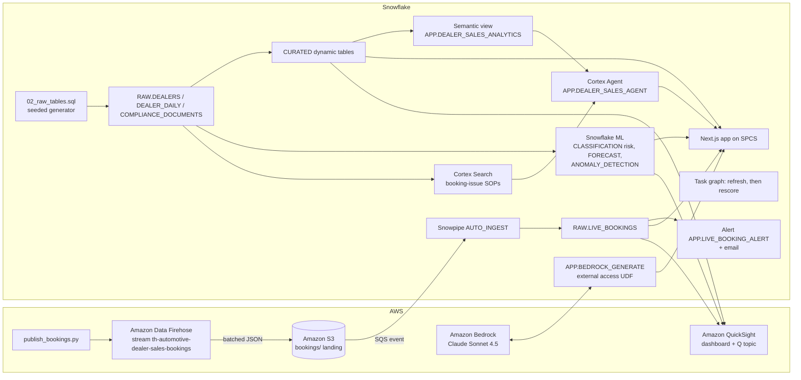

# Thailand Automotive Dealer Network - Booking Integrity and Sales Risk

Dealer sales monitoring for **40 fictional showrooms of a fictional Thai vehicle distributor**, selling five vehicle segments in five real cities used as regions (Bangkok, Chiang Mai, Khon Kaen, Chon Buri, Hat Yai). Snowflake, optionally with AWS, takes the network sales team from a live booking issue to a 7-day booking-cancellation risk score per dealer, an alert email and an AI action memo.

## Architecture

The pipeline runs on **Snowflake** (Dynamic Tables, Snowflake ML, Cortex Search, Cortex Agent, Cortex AI_COMPLETE, SPCS) and, in the full build, also uses **AWS** (Amazon Data Firehose, S3, Bedrock Claude, QuickSight + Amazon Q). Booking events arrive in `RAW.LIVE_BOOKINGS`. Dynamic tables roll 90 days of dealer-day rows into vehicle bookings, booking value in THB, booking issues, cancelled bookings, late deliveries, clean booking rate and stock audit compliance. Snowflake ML predicts which dealers are likely to have a cancelled booking in the next 7 days, forecasts booking issues across the network and flags unusual finance decline rates. A Cortex Agent answers with SQL and SOP citations, and an LLM drafts the network sales team's action memo.

Interactive diagrams (hover for object names): [Snowflake only](docs/architecture-snowflake.html) | [AWS + Snowflake](docs/architecture-aws.html). The app's Architecture & Data tab shows both, the current build first. Regenerate them with `python3 docs/build_architecture.py aws snowflake`.



In the Snowflake-only build there is no AWS subgraph: `APP.SIMULATE_BOOKINGS` writes to `RAW.LIVE_BOOKINGS`, and the app calls Cortex `AI_COMPLETE` in place of the Bedrock UDF.

## Snowflake Capabilities

| Capability | Implementation |
|-----------|---------------|
| Dynamic Tables | `CURATED.KPI_SUMMARY`, `PERFORMANCE_SUMMARY`, `ISSUE_SUMMARY`, `TREND_ANALYSIS`, built from the RAW tables |
| Snowflake ML | CLASSIFICATION of 7-day booking-cancellation risk (`ML.CANCEL_RISK_SCORES`), a 14-day booking-issue FORECAST, and finance decline rate ANOMALY_DETECTION |
| Cortex Search | 13 synthetic booking-issue SOPs (one per vehicle segment and issue type) in `SEARCH.ISSUE_SOP_SEARCH` |
| Semantic View | `APP.DEALER_SALES_ANALYTICS` over dealers, issue types, daily totals and risk |
| Cortex Agent | `APP.DEALER_SALES_AGENT`: Cortex Analyst over the semantic view, plus Cortex Search for SOP citations |
| Cortex AI | `AI_COMPLETE('claude-sonnet-4-5')` for grounded answers, and for the action memo in the Snowflake-only build |
| Alerts + Tasks | `APP.LIVE_BOOKING_ALERT` logs ISSUE events and sends email; task graph `TASK_REFRESH_CURATED`, then `TASK_RESCORE_RISK` |
| Snowpark Container Services | Next.js app `APP.TH_AUTOMOTIVE_DEALER_SALES_APP` with 6 tabs: Executive Cockpit, Predictive, Controls, Live Bookings, Ask AI, Architecture & Data |
| Snowpipe | `RAW.LIVE_BOOKINGS_PIPE` AUTO_INGEST from S3 (AWS build only) |

## AWS Services

These run only in the AWS + Snowflake build.

| Service | Role in Demo |
|---------|-------------|
| Amazon Data Firehose | Direct PUT stream `th-automotive-dealer-sales-bookings` takes simulated booking events and writes them to S3 in batches |
| Amazon S3 | Landing bucket (`bookings/`); an event notification goes to the Snowpipe SQS queue |
| Amazon Bedrock | Claude Sonnet 4.5 drafts the action memo, called from Snowflake through an external-access UDF |
| Amazon QuickSight | DIRECT_QUERY dealer sales dashboard over Snowflake (daily booking issues, cancelled bookings by dealer, booking-cancellation risk) |
| Amazon Q | Natural-language questions over the QuickSight topic `th-automotive-dealer-sales-topic` |
| AWS IAM | Least-privilege roles for S3, Firehose and Bedrock |

## Personas

Both personas are fictional.

| Persona | Role | Key Questions |
|---------|------|---------------|
| **Siriporn Chaiyasit** | Head of Dealer Network Sales | "How many vehicle bookings go through without an issue?" "Which issue types end in a cancelled booking most often?" |
| **Nattapong Srisuk** | Dealer Sales Analyst | "Which dealers need a sales review this week, and what does the SOP say to do?" |

## Data

Every table is synthetic and HASH-seeded, so a rebuild reproduces it. The distributor, its dealers and all names are fictional; the five cities are real Thai cities used only as regions.

| Table | Rows | Description |
|-------|------|-------------|
| RAW.DEALERS | 40 | Dealers in 5 Thai cities and 5 vehicle segments (Pickup truck, Eco car, SUV, Electric vehicle, Commercial van), with an operating risk tier |
| RAW.DEALER_DAILY | 3,600 | One row per dealer per day for 90 days: bookings, booking value (THB), booking issues, cancelled bookings, late deliveries, issue type, stock audits, finance decline rate and lead response time |
| RAW.COMPLIANCE_DOCUMENTS | 40 | Required, on-file and pending dealer documents per dealer |
| SEARCH.ISSUE_DOCS | 13 | Synthetic booking-issue SOPs indexed for Cortex Search |
| RAW.LIVE_BOOKINGS | Grows during the demo | Live booking events from Firehose (AWS build) or `APP.SIMULATE_BOOKINGS` (Snowflake-only build) |
| ML.CANCEL_RISK_SCORES | 40 | 7-day booking-cancellation probability and risk band per dealer |

## Build Instructions

### Prerequisites
- Snowflake account with ACCOUNTADMIN access, and Cortex AI enabled (AI_COMPLETE, Search, Agent).
- An X-Small warehouse with auto-suspend at or below 120 s, and an existing SPCS compute pool.
- Python 3.11+, `snowflake-connector-python`, Node.js 22+, Docker and the `snow` CLI.
- App image: run `snow spcs image-registry login`, then build and push `th-automotive-dealer-sales-app:v1` to the database's `APP.IMAGES` repository (see the header of `snowflake/07_deploy_app.sql`).
- AWS build only: `boto3`, AWS credentials for the target account (us-west-2) with Bedrock access, and QuickSight Enterprise.

### SPCS App
```
<DATABASE>.APP.TH_AUTOMOTIVE_DEALER_SALES_APP
```

### Tests
```bash
python -m pytest aws snowflake quicksight
```

For a local run, put `SNOWFLAKE_ACCOUNT`, `SNOWFLAKE_USER`, `SNOWFLAKE_DATABASE`, `SNOWFLAKE_WAREHOUSE`, `SNOWFLAKE_AUTHENTICATOR=PROGRAMMATIC_ACCESS_TOKEN`, `SNOWFLAKE_TOKEN` and `DEMO_PLATFORM` in the environment, then run `npm --prefix app run build && npm --prefix app start`.

## Build Modes

The two modes run on one shared core and differ in three layers. The `DEMO_PLATFORM` value in the app SPCS spec selects the memo provider and the Live Bookings copy.

| Layer | Snowflake Only | Full AWS + Snowflake |
|---|---|---|
| Live bookings | `CALL APP.SIMULATE_BOOKINGS(n)` inserts simulated booking events into `RAW.LIVE_BOOKINGS`. This simulates a booking feed; it is not Snowpipe Streaming | `aws/publish_bookings.py` to Amazon Data Firehose, then S3, SQS and Snowpipe AUTO_INGEST |
| Action memo | Cortex `AI_COMPLETE('claude-sonnet-4-5')` | Amazon Bedrock Claude Sonnet 4.5 through `APP.BEDROCK_GENERATE` |
| BI and natural-language questions | The SPCS app is the dashboard; questions go to the Cortex Agent | Also a QuickSight dashboard and an Amazon Q topic |
| App setting | `DEMO_PLATFORM: snowflake` | `DEMO_PLATFORM: aws` |

### Snowflake Only

```bash
# 1. Core data and dynamic tables (guarded: new isolated database only)
python snowflake/run_core.py --database THAILAND_AUTOMOTIVE_DEALER_SALES_SNOWFLAKE --warehouse <XS_WAREHOUSE> --connection <CONNECTION> --apply
# 2. Native booking feed, ML, search, semantic view, agent, alert and task graph
python snowflake/run_intelligence.py --database THAILAND_AUTOMOTIVE_DEALER_SALES_SNOWFLAKE --platform snowflake --warehouse <XS_WAREHOUSE> --connection <CONNECTION> --alert-email you@example.com
# 3. App on SPCS with DEMO_PLATFORM=snowflake (push the image first)
python snowflake/run_intelligence.py --database THAILAND_AUTOMOTIVE_DEALER_SALES_SNOWFLAKE --platform snowflake --warehouse <XS_WAREHOUSE> --connection <CONNECTION> --alert-email you@example.com --files 07_deploy_app.sql --compute-pool <COMPUTE_POOL>
```

During the demo:
- Run `CALL APP.SIMULATE_BOOKINGS(20)` to add live booking events. For a continuous feed, run `ALTER TASK APP.TASK_SIMULATE_BOOKINGS RESUME`, and `SUSPEND` it afterwards.
- Run `EXECUTE ALERT APP.LIVE_BOOKING_ALERT` to raise the alert email.
- Run `EXECUTE TASK APP.TASK_REFRESH_CURATED` to refresh the curated tables and rescore risk.

Afterwards, drop the database or run `ALTER SERVICE APP.TH_AUTOMOTIVE_DEALER_SALES_APP SUSPEND`.

### Full AWS + Snowflake

```bash
# 1. Core data and dynamic tables (guarded: new isolated database only)
python snowflake/run_core.py --database THAILAND_AUTOMOTIVE_DEALER_SALES_AWS --warehouse <XS_WAREHOUSE> --connection <CONNECTION> --apply
# 2. AWS ingestion and Bedrock (dry run first, then --apply)
python aws/setup_aws.py --database THAILAND_AUTOMOTIVE_DEALER_SALES_AWS --account <AWS_ACCOUNT_ID> --connection <CONNECTION> --apply
# 3. ML, search, semantic view, agent, alert and task graph
python snowflake/run_intelligence.py --database THAILAND_AUTOMOTIVE_DEALER_SALES_AWS --platform aws --warehouse <XS_WAREHOUSE> --connection <CONNECTION> --alert-email you@example.com
# 4. App on SPCS with DEMO_PLATFORM=aws (push the image first)
python snowflake/run_intelligence.py --database THAILAND_AUTOMOTIVE_DEALER_SALES_AWS --platform aws --warehouse <XS_WAREHOUSE> --connection <CONNECTION> --alert-email you@example.com --files 07_deploy_app.sql --compute-pool <COMPUTE_POOL>
# 5. QuickSight dashboard and Q topic (needs an existing Snowflake data source)
python quicksight/build_dashboards.py --database THAILAND_AUTOMOTIVE_DEALER_SALES_AWS --account <AWS_ACCOUNT_ID> --principal-arn <QUICKSIGHT_USER_ARN> --data-source-arn <DATA_SOURCE_ARN> --prefix th-automotive-dealer-sales --apply --update --with-topic
```

QuickSight objects must be shared with the QuickSight user who signs in (`--principal-arn`); otherwise the console shows nothing.

During the demo:
- Run `python aws/publish_bookings.py --count 20` to send live booking events. Firehose buffers for up to 60 seconds before writing to S3.
- Run `EXECUTE ALERT APP.LIVE_BOOKING_ALERT` to raise the alert email.
- Run `EXECUTE TASK APP.TASK_REFRESH_CURATED` to refresh the curated tables and rescore risk.


When you are done, `python aws/teardown_aws.py --database THAILAND_AUTOMOTIVE_DEALER_SALES_AWS --account <AWS_ACCOUNT_ID> --connection <CONNECTION> --apply` deletes the AWS resources plus the account-level Bedrock external-access and S3 storage integrations. The email integration `TH_AUTOMOTIVE_DEALER_SALES_EMAIL_INT` stays, because the Snowflake-only build uses it too.

## Business Impact

Industry research and a Snowflake customer outcome:
- **Thai vehicle demand fell sharply in 2024**: "The rebounds for local output and domestic sales are from steep contractions of 20.2% and 26%, respectively, last year." -- [Bangkok Post, Krungsri: Auto sales to rebound in 2025 (5 March 2025)](https://www.bangkokpost.com/business/general/2973168/krungsri-auto-sales-to-rebound-in-2025)
- **Tight lending shapes vehicle sales**: "The marginal growth rates of both vehicle and home sales this year align with slower growth of the Thai economy amid high household debt levels and tight loan criteria in those segments" -- [Bangkok Post, Krungsri: Auto sales to rebound in 2025 (5 March 2025)](https://www.bangkokpost.com/business/general/2973168/krungsri-auto-sales-to-rebound-in-2025)
- **BMW Group** (Snowflake customer): "On its service data workloads, BMW Group has reduced average costs by 25% with Snowflake compared to its legacy platform", with "more than 60 CDH use cases — spanning sales and service to supply chain — up and running on Snowflake in just 18 months" -- [Snowflake customer story: BMW Group](https://www.snowflake.com/en/customers/all-customers/case-study/bmw-group/)

## Key Demo Numbers

All figures are synthetic and come from the seeded demo data. Forecast and anomaly figures can shift slightly with the build day.

- **40 dealers** in 5 Thai cities and 5 vehicle segments, 3,600 dealer-days over 90 days: **16,180 vehicle bookings** worth THB 14.54 B
- **Clean booking rate 96.49%**: **568 booking issues**, of which **139** ended as cancelled bookings (issue cancellation rate 24.5%), and **68 late deliveries**
- **Finance application declined** causes the most cancelled bookings (54 of 195 issues); the 16 flood-related delivery disruption issues (Hat Yai and Chiang Mai) were all resolved without a cancellation
- Dealers in **Chiang Mai** have the most cancelled bookings (39); Hat Yai has the fewest (17)
- **Booking-cancellation model**, out-of-time holdout: precision 0.50 and recall 0.37 at a 0.5 threshold, against a 0.19 base rate. 4 dealers are high risk; the top one, DLR-0035, scores 94.9%
- **14-day booking-issue forecast** with prediction intervals; **39 of 640** recent dealer-days flagged as finance decline rate anomalies
- **Stock audit compliance 78.5%**; dealer document coverage 56.4%, with 17 documents pending
- **13 SOPs** indexed in Cortex Search and cited by ID in agent answers

## License

Apache 2.0 — See [LICENSE](LICENSE) for details.

This is a personal demo project and is not an official Snowflake offering. It comes with no support or warranty. Industry metrics cited are from publicly available third-party research and Snowflake customer stories; they represent reported outcomes and are not guarantees of results.
